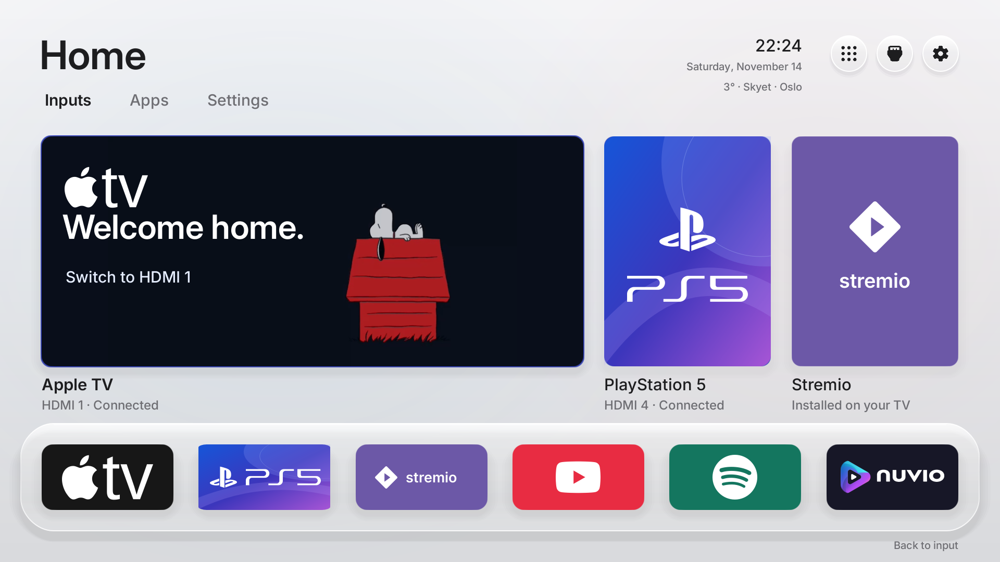
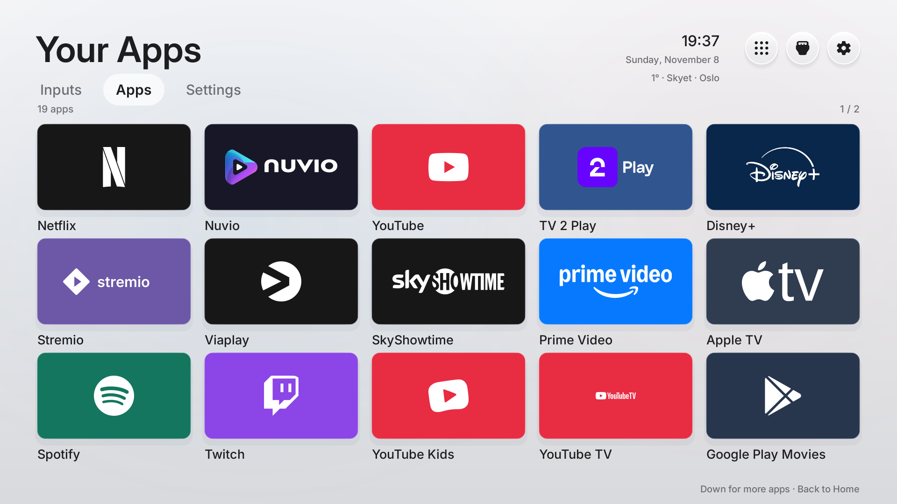
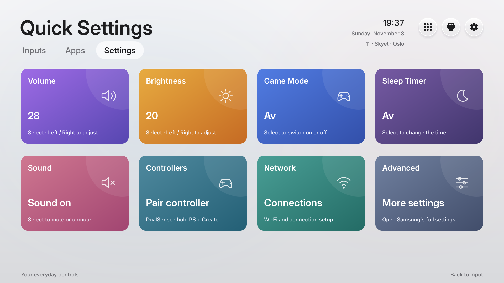

# Better-Tizen

A custom Samsung Tizen Home menu based on the native .NET/NUI launcher from [Quiet Tizen](https://github.com/jss8649/quiet-tizen). It reuses upstream rendering, navigation, app launching and settings code, with additions for live sources, installed apps and locally stored preferences.

The current **Tizen 10** port is a standalone native application in [`quiet-native/tizen10/`](quiet-native/tizen10/), signed with a Samsung TV certificate profile, with app/package ID `org.bettertizen.home`. It uses .NET 8 and API13 references and keeps its resources and preferences in its own package. The previous Tizen 9 deployment and the earlier web launcher remain available as legacy source.

## Compatibility and verification

The standalone port has been installed and rendered on **Samsung TQ65QN85FAUXXC**, Tizen **10.0**, ARMv7, **.NET 8.0.11**. Live app/HDMI discovery, fonts, weather and app-scene PNG capture have been checked. This is one device profile, not universal Tizen 10 compatibility.

[Nuvio 1.4.1](https://github.com/NuvioMedia/NuvioTVSmart/releases/tag/1.4.1) was installed alongside this recovery; its version was checked in the TV's live application inventory.

The old native-main-operation setter is denied on this profile. The new app instead watches the native foreground value and requests its own return after stable Samsung Home observations. On **14 November 2026**, the user confirmed both Home-key return from Nuvio and automatic return after their power/restart test. **Samsung's standard Home appears for a few seconds before Quiet opens.** This is foreground recovery, not an immediate exclusive replacement of Samsung's launcher.

Passive reports retained the same kernel boot ID across that test, so it does not establish a fresh kernel cold boot. **A full mains-disconnected cold start with the new app remains untested.** The two Home/startup strings have been configured and read back successfully, with auto-start already enabled; that readback alone does not prove the full cold-start path.

The previous Tizen 9 / .NET 6 deployment replaced Bixby Promotion's assembly. An OS upgrade changed that container and removed the earlier developer installation. The Tizen 10 app leaves Samsung's package and native-image cache intact. See the [native notes](quiet-native/README.md) for the two deployment paths and their separate recovery requirements.

## Screenshots

The Home image shows the standalone Tizen 10 app, captured directly from the tested Samsung TV on 14 November 2026.



This is a still capture of the live app. Installed apps, optional artwork and ambient media reflect the tested TV.

<details>
<summary>App library and quick settings (previous native build)</summary>

These two captures are from the Tizen 9 version on 8 November 2026; the standalone app retains its UI layout.





</details>

## Features

- Home, Apps and Settings pages with remote-control navigation.
- Live HDMI and installed-app discovery, including device artwork for Apple TV and PlayStation.
- Two recent-source cards that follow successful app or HDMI selections, independently of favorite order.
- Automatic favorites, manual favorites and usage history stored locally on the TV.
- Optional local ambient videos with matching posters, preserved aspect ratio and pause/resume handling.
- Clock, date and cached weather. The shared weather implementation is configured for **Oslo** in `quiet-native/src/NativeData.cs`.
- Native Home re-entry and opt-in startup configuration, with separate device verification for Home, wake and cold boot.

The app catalog contains artwork mappings, not a fixed list of installed apps. Nuvio appears when installed; its background services are excluded from app tiles. Nuvio itself is obtained separately from the [official releases](https://github.com/NuvioMedia/NuvioTVSmart/releases).

## Build

For the standalone Tizen 10 app, install Python 3 and the .NET 8 SDK, then clone the pinned upstream source:

```sh
git clone --recurse-submodules https://github.com/Chrissddd/Better-Tizen.git
cd Better-Tizen
python3 quiet-native/tizen10/build.py --dotnet /path/to/dotnet --unsigned
```

An unsigned package is a local review artifact. For TV installation, sign with your own Samsung certificate profile and its private password file:

```sh
python3 quiet-native/tizen10/build.py --dotnet /path/to/dotnet \
  --profile YOUR_TV_PROFILE --profiles /private/path/profiles.xml \
  --password-file /private/path/certificate-password
```

Build output stays under ignored `quiet-native/tizen10/.local/`. The builder does not connect to a TV. See the [native build and deployment notes](quiet-native/README.md) before installing or opting into startup changes.

The older `quiet-native/build.py` targets the **legacy Tizen 9 container deployment** and needs that TV's four private framework assemblies. Its output and restoration scripts are not Tizen 10 upgrades.

Standalone packaging, data and startup tests use synthetic fixtures and do not contact a TV:

```sh
python3 -m unittest discover -s quiet-native/tizen10/tests -p 'test_build.py' -v
dotnet run --project quiet-native/tizen10/tests/DataTests.csproj -c Release
python3 quiet-native/tizen10/tests/run_startup_tests.py --dotnet /path/to/dotnet
```

## Local device configuration

The standalone builder needs no TV address or root-transport configuration. For the historical maintenance tools, copy [`scripts/device.example.json`](scripts/device.example.json) to the ignored `.local/device.json` and set your TV address, the computer's reachable callback address, and paths to your separately obtained SDB and temporary-root payloads. The example addresses are documentation placeholders.

Environment overrides are `TV_IP`, `TV_CALLBACK_IP`, `SDB` and `TV_ROOT_PAYLOADS`; `TV_CONFIG` selects a different private configuration file. Keep your actual device configuration local. Review the deployment notes and scripts before running tools that change a TV.

The historical operation and temporary-root tools require **Python 3.12 or later**. Their root transport is separate from the standalone Tizen 10 build; the previously used command route is unavailable on the tested upgraded TV. The old payload build instructions remain in the [legacy native notes](quiet-native/README.md#legacy-tizen-9-deployment).

## Media and private files

Snoopy videos, matching poster images, personal wallpapers, private app settings and artwork retrieved from the TV are omitted from the public repository. Supply media you are entitled to use; the native build also works without ambient videos. Missing optional app artwork uses a text fallback. Instructions and expected filenames are in the [native README](quiet-native/README.md#optional-media-and-settings).

Private device snapshots, diagnostic reports, credentials, generated packages and proprietary binaries stay local. The public source does not configure a Samsung account or a Nuvio account.

## Credits and licenses

The native launcher starts from [Quiet Tizen](https://github.com/jss8649/quiet-tizen), pinned as the `research/quiet-tizen` submodule. Its upstream code, artwork, fonts and third-party notices retain their original licenses. See [UPSTREAM-NOTICE.md](UPSTREAM-NOTICE.md) and the notices distributed alongside the assets. Product names and logos belong to their respective owners.
